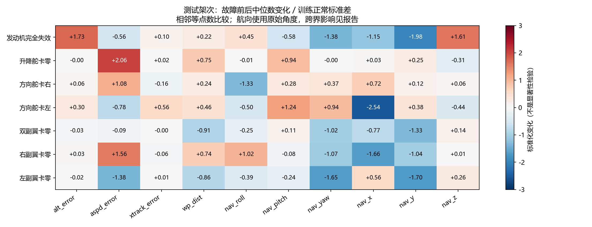
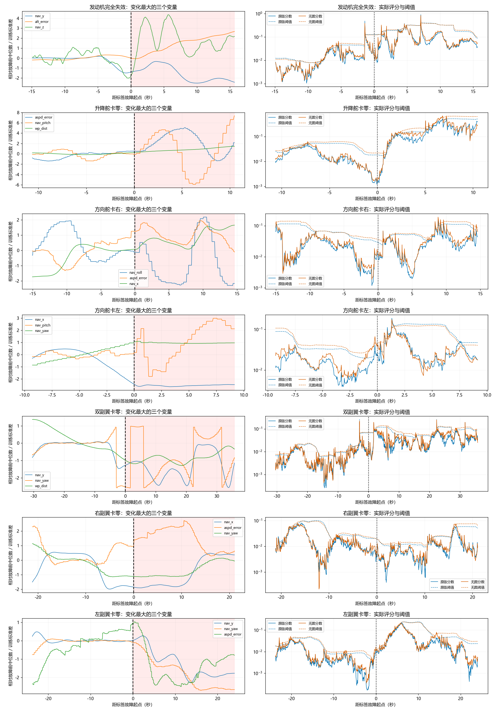

# ALFA 故障数据差异检查（2026-10-08）

## 方法与覆盖
检查 V12 的 46 个有标签原始 CSV（排除 no_ground_truth）、当前 7 个测试架次，以及 baseline/no_graph 已保存评分。46 个文件特征缺失与无穷值均为 0，时间戳均严格递增。
故障起点前后使用相同点数 n=min(故障长度, 紧邻故障前正常段长度,600)，n>=30。幅值指标为中位数之差除以训练正常标准差；波动指标为四分位距 IQR 的后/前比。前后片段不一定等时长。相关性使用 Spearman，描述共同变化而非因果。
原始文件名用于沿用现有故障类型映射，不是新增人工标签。左副翼类别有一个 rudder_zero__left_aileron 混合文件，跨架次结论应单独核对。
nav_yaw 为环绕角度：原始角度相关性、四分位距和中位数可能受跨界影响。nav_x/y/z 的物理含义及 aspd_error 的单位没有在本次分析中从原始采集文档验证，不将它们直接解释成位置或速度。
本分析没有重新拟合模型，也未改变划分；不作独立样本显著性检验，因为时间点自相关且每类测试只有一架次。

## 各测试架次

### 发动机完全失效
源文件：`carbonZ_2018-07-18-16-22-01_engine_failure_with_emr_traj.csv`。起点行（0 基）：2234；故障 297 点，首末时间跨度 15.68 秒；比较前后各 297 点。

|变量|中位数变化/训练标准差|IQR 后/前|
|---|---:|---:|
|alt_error|+1.732|3.551|
|aspd_error|-0.560|2.960|
|xtrack_error|+0.102|10.211|
|wp_dist|+0.220|0.562|
|nav_roll|+0.445|2.465|
|nav_pitch|-0.579|1.249|
|nav_yaw|-1.375|25.138|
|nav_x|-1.152|1.662|
|nav_y|-1.979|6.682|
|nav_z|+1.606|1.930|

航向原值中位数变化 -138.62°；按时间解缠后 +105.45°（解缠假设相邻真实变化小于 180°）。
排除航向的平均绝对相关系数变化：0.434；同架次正常/正常相邻窗口参照中位数：0.429，共 23 个重叠参照。

|模型|正常分数中位数|异常分数中位数|异常阈值中位数|原始召回|首次命中延迟/s|
|---|---:|---:|---:|---:|---:|
|baseline|0.01227|0.06790|0.22222|2.36%|1.099|
|no_graph|0.01359|0.07481|0.22660|2.02%|1.099|
正常分数统计使用该测试架次全部有效正常点；异常分数统计使用全部有效异常点，不能将两个中位数之比当作分类指标。首次命中只统计标签起点之后，不表示之前没有误报。

### 升降舵卡零
源文件：`carbonZ_2018-09-11-14-41-51_elevator_failure.csv`。起点行（0 基）：2300；故障 206 点，首末时间跨度 10.49 秒；比较前后各 206 点。

|变量|中位数变化/训练标准差|IQR 后/前|
|---|---:|---:|
|alt_error|-0.004|6.632|
|aspd_error|+2.056|3.139|
|xtrack_error|+0.020|0.516|
|wp_dist|+0.754|1.967|
|nav_roll|-0.015|0.222|
|nav_pitch|+0.936|10.263|
|nav_yaw|-0.002|0.257|
|nav_x|+0.029|0.588|
|nav_y|+0.248|8.289|
|nav_z|-0.312|6.415|

航向原值中位数变化 -0.19°；按时间解缠后 -0.19°（解缠假设相邻真实变化小于 180°）。
排除航向的平均绝对相关系数变化：0.620；同架次正常/正常相邻窗口参照中位数：0.523，共 38 个重叠参照。

|模型|正常分数中位数|异常分数中位数|异常阈值中位数|原始召回|首次命中延迟/s|
|---|---:|---:|---:|---:|---:|
|baseline|0.00957|0.13141|0.19513|18.45%|0.658|
|no_graph|0.01177|0.15286|0.25207|22.33%|0.658|
正常分数统计使用该测试架次全部有效正常点；异常分数统计使用全部有效异常点，不能将两个中位数之比当作分类指标。首次命中只统计标签起点之后，不表示之前没有误报。

### 方向舵卡右
源文件：`carbonZ_2018-09-11-15-06-34_1_rudder_right_failure.csv`。起点行（0 基）：1076；故障 291 点，首末时间跨度 14.64 秒；比较前后各 291 点。

|变量|中位数变化/训练标准差|IQR 后/前|
|---|---:|---:|
|alt_error|+0.062|2.052|
|aspd_error|+1.084|0.765|
|xtrack_error|-0.158|4.376|
|wp_dist|+0.236|0.922|
|nav_roll|-1.325|1.549|
|nav_pitch|+0.282|4.463|
|nav_yaw|+0.368|1.620|
|nav_x|+0.717|0.613|
|nav_y|+0.124|3.239|
|nav_z|+0.061|1.456|

航向原值中位数变化 +37.05°；按时间解缠后 +38.43°（解缠假设相邻真实变化小于 180°）。
排除航向的平均绝对相关系数变化：0.617；同架次正常/正常相邻窗口参照中位数：0.437，共 7 个重叠参照。

|模型|正常分数中位数|异常分数中位数|异常阈值中位数|原始召回|首次命中延迟/s|
|---|---:|---:|---:|---:|---:|
|baseline|0.01264|0.02532|0.05228|7.56%|0.737|
|no_graph|0.01573|0.03318|0.05646|6.19%|0.737|
正常分数统计使用该测试架次全部有效正常点；异常分数统计使用全部有效异常点，不能将两个中位数之比当作分类指标。首次命中只统计标签起点之后，不表示之前没有误报。

### 方向舵卡左
源文件：`carbonZ_2018-09-11-15-06-34_3_rudder_left_failure.csv`。起点行（0 基）：1187；故障 180 点，首末时间跨度 9.16 秒；比较前后各 180 点。

|变量|中位数变化/训练标准差|IQR 后/前|
|---|---:|---:|
|alt_error|+0.296|10.689|
|aspd_error|-0.779|16.207|
|xtrack_error|+0.564|139.601|
|wp_dist|+0.460|nan|
|nav_roll|-0.503|2.128|
|nav_pitch|+1.240|9.119|
|nav_yaw|+0.944|0.047|
|nav_x|-2.543|0.065|
|nav_y|+0.381|0.158|
|nav_z|-0.440|7.166|

航向原值中位数变化 +95.17°；按时间解缠后 +95.17°（解缠假设相邻真实变化小于 180°）。
排除航向的平均绝对相关系数变化：0.539；同架次正常/正常相邻窗口参照中位数：0.313，共 19 个重叠参照。

|模型|正常分数中位数|异常分数中位数|异常阈值中位数|原始召回|首次命中延迟/s|
|---|---:|---:|---:|---:|---:|
|baseline|0.01647|0.02358|0.12262|11.11%|0.274|
|no_graph|0.02107|0.02436|0.11604|6.11%|0.274|
正常分数统计使用该测试架次全部有效正常点；异常分数统计使用全部有效异常点，不能将两个中位数之比当作分类指标。首次命中只统计标签起点之后，不表示之前没有误报。

### 双副翼卡零
源文件：`carbonZ_2018-09-11-17-27-13_2_both_ailerons_failure.csv`。起点行（0 基）：1303；故障 701 点，首末时间跨度 35.79 秒；比较前后各 600 点。

|变量|中位数变化/训练标准差|IQR 后/前|
|---|---:|---:|
|alt_error|-0.026|2.193|
|aspd_error|-0.089|1.252|
|xtrack_error|-0.004|10.214|
|wp_dist|-0.909|0.291|
|nav_roll|-0.245|2.100|
|nav_pitch|+0.108|1.650|
|nav_yaw|-1.017|23.533|
|nav_x|-0.774|12.087|
|nav_y|-1.334|6.659|
|nav_z|+0.141|1.039|

航向原值中位数变化 -102.46°；按时间解缠后 +107.13°（解缠假设相邻真实变化小于 180°）。
排除航向的平均绝对相关系数变化：0.358；同架次正常/正常相邻窗口参照中位数：0.439，共 1 个重叠参照。

|模型|正常分数中位数|异常分数中位数|异常阈值中位数|原始召回|首次命中延迟/s|
|---|---:|---:|---:|---:|---:|
|baseline|0.00492|0.03083|0.07962|3.99%|1.741|
|no_graph|0.00558|0.04110|0.09405|3.42%|1.741|
正常分数统计使用该测试架次全部有效正常点；异常分数统计使用全部有效异常点，不能将两个中位数之比当作分类指标。首次命中只统计标签起点之后，不表示之前没有误报。

### 右副翼卡零
源文件：`carbonZ_2018-09-11-17-55-30_1_right_aileron_failure.csv`。起点行（0 基）：2217；故障 419 点，首末时间跨度 21.09 秒；比较前后各 419 点。

|变量|中位数变化/训练标准差|IQR 后/前|
|---|---:|---:|
|alt_error|+0.030|0.707|
|aspd_error|+1.555|1.548|
|xtrack_error|-0.057|1.587|
|wp_dist|+0.742|4.515|
|nav_roll|+1.016|0.715|
|nav_pitch|-0.085|0.560|
|nav_yaw|-1.066|0.901|
|nav_x|-1.658|0.968|
|nav_y|-1.035|0.761|
|nav_z|+0.009|0.669|

航向原值中位数变化 -107.47°；按时间解缠后 -107.47°（解缠假设相邻真实变化小于 180°）。
排除航向的平均绝对相关系数变化：0.397；同架次正常/正常相邻窗口参照中位数：0.383，共 14 个重叠参照。

|模型|正常分数中位数|异常分数中位数|异常阈值中位数|原始召回|首次命中延迟/s|
|---|---:|---:|---:|---:|---:|
|baseline|0.01071|0.00643|0.01804|6.21%|2.901|
|no_graph|0.01227|0.00772|0.01793|6.92%|2.901|
正常分数统计使用该测试架次全部有效正常点；异常分数统计使用全部有效异常点，不能将两个中位数之比当作分类指标。首次命中只统计标签起点之后，不表示之前没有误报。

### 左副翼卡零
源文件：`carbonZ_2018-10-05-14-37-22_3_left_aileron_failure.csv`。起点行（0 基）：1405；故障 463 点，首末时间跨度 24.01 秒；比较前后各 463 点。

|变量|中位数变化/训练标准差|IQR 后/前|
|---|---:|---:|
|alt_error|-0.016|3.508|
|aspd_error|-1.383|1.283|
|xtrack_error|+0.009|2.952|
|wp_dist|-0.856|0.623|
|nav_roll|-0.390|4.508|
|nav_pitch|-0.240|3.361|
|nav_yaw|-1.647|31.292|
|nav_x|+0.562|29.944|
|nav_y|-1.697|16.341|
|nav_z|+0.262|1.594|

航向原值中位数变化 -165.95°；按时间解缠后 -165.95°（解缠假设相邻真实变化小于 180°）。
排除航向的平均绝对相关系数变化：0.436；同架次正常/正常相邻窗口参照中位数：0.402，共 5 个重叠参照。

|模型|正常分数中位数|异常分数中位数|异常阈值中位数|原始召回|首次命中延迟/s|
|---|---:|---:|---:|---:|---:|
|baseline|0.00727|0.01897|0.04763|7.56%|0.000|
|no_graph|0.00829|0.02221|0.07137|6.26%|0.000|
正常分数统计使用该测试架次全部有效正常点；异常分数统计使用全部有效异常点，不能将两个中位数之比当作分类指标。首次命中只统计标签起点之后，不表示之前没有误报。

## 原始文件中的跨架次支持
|类型|可比较架次|中位绝对变化最大的三个变量|
|---|---:|---|
|双副翼卡零|2|nav_y=1.98, nav_yaw=1.36, wp_dist=0.64|
|升降舵卡零|2|aspd_error=1.42, wp_dist=1.06, nav_pitch=0.66|
|发动机完全失效|23|nav_yaw=1.69, nav_z=1.36, nav_y=1.27|
|左副翼卡零|3|nav_y=1.70, nav_yaw=1.65, nav_x=0.56|
|右副翼卡零|3|aspd_error=1.23, nav_yaw=1.07, nav_y=1.04|
|方向舵卡左|1|nav_x=2.54, nav_pitch=1.24, nav_yaw=0.94|
|方向舵卡右|2|nav_roll=1.43, nav_pitch=1.42, wp_dist=1.35|

## 评分曲线
