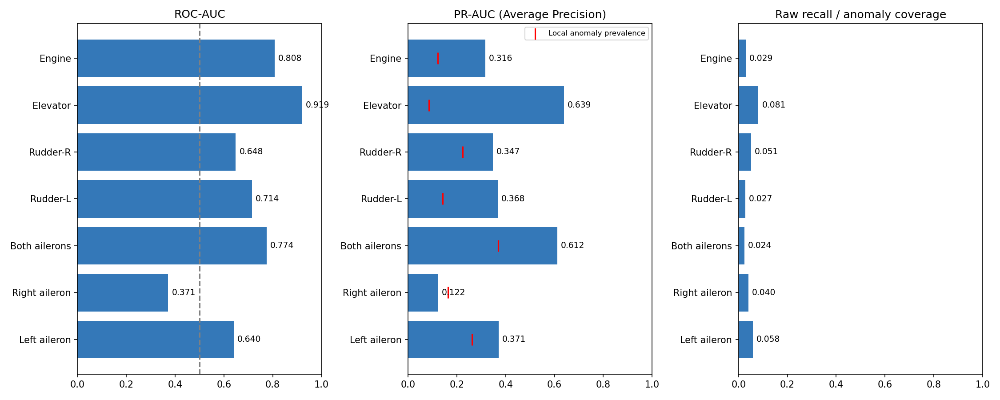
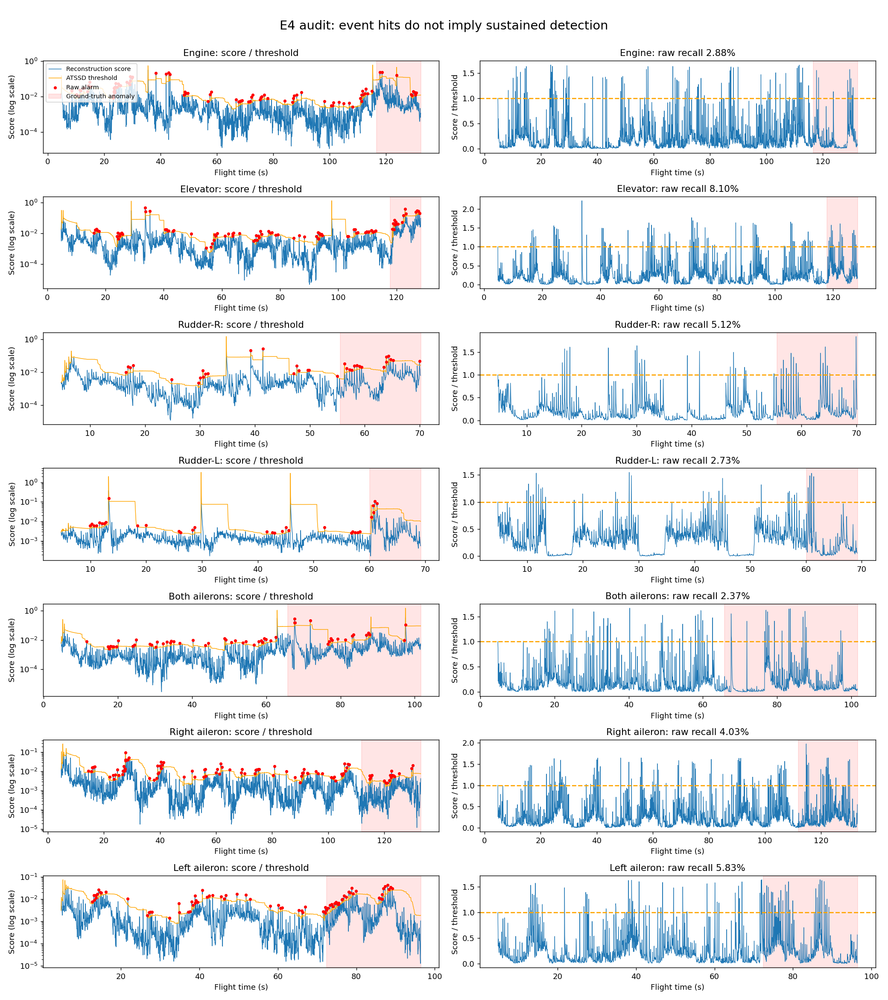
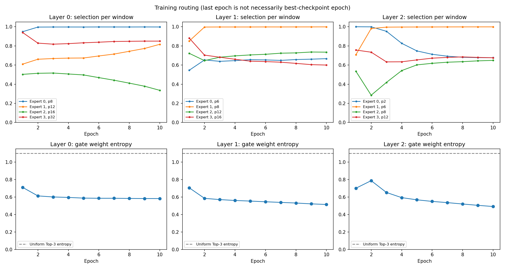
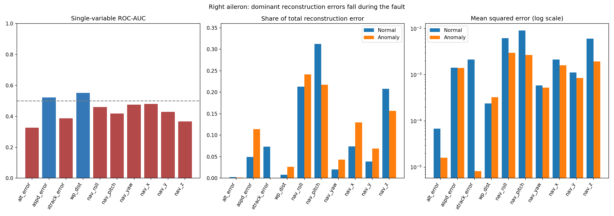

# E4 服务器训练结果分析

分析日期：2026-10-26。原始结果保持不变；本目录只保存重算报告、图表和诊断脚本。

## 结论

这次 E4 已完成正式训练和测试，导出结果可以独立复算，但当前主要评价指标较弱：
**Raw F1=6.98%、Raw Recall=4.13%、ROC-AUC=0.6515、PR-AUC/AP=0.3210**。
7/7 事件命中及 PA-F1=93.41% 不能替代 Raw 检测质量。

目前同时存在异常分数区分力不足、ATSSD 下持续覆盖低、路由权重偏向单个专家等现象。
在冻结 E4 权重的小样本检查中，Granger 偏置对分数有非零但较弱的即时影响。
这还不能证明 Granger 方法本身无效，也不能证明变量级表示不如原模型：
缺少相同 20Hz 数据和训练预算的 E0/E1/E2/E3/E5 完整训练结果。

## 1. 锁定这次运行

- setting：`ALFA10vars_MSTGCNet_sl96_dm64_el3_causal_last_atssd_v12_finegrained_E4_cfg515879a959_0`。
- 服务器 Git：`6397638d02bd362dfb30cb43ee2d1fd9a7322db6`，分支 `exp/variable-granger-v1`。
- 记录环境：Python 3.12.15、NumPy 1.26.4、PyTorch 2.12.1+cu126。
- E4、d_var=16、graph_dim=16、lambda_prior=1、3 层、每层 4 专家、Top-K=3。
- Patch：`[8,12,16,32] / [6,8,12,16] / [2,6,8,12]`。
- batch=128、lr=1e-4、最大 10 轮、patience=3、seed=2025、dropout=0.1。
- 原逐窗口平方误差求和损失、均衡损失系数0.01、无 AMP、无额外结构损失。
- `causal_last`、`score_normalization=none`、ATSSD、winsize=96、alpha=0.01。
- 20Hz ZOH 数据，模型窗口 96 点约 4.8 秒；首次得到最后点评分前有 95 点热身。

checkpoint SHA256：
`7c3769b8a10bec29c633d6876d0496baf7f07afc202b71c2dd1265c8a431b1cb`。

模型共 336,938 参数，可微有效路径参数 325,418。服务器导出的 CPU 推理微基准为
4线程、batch=1、warmup=2、重复5次，中位17.17毫秒/窗口。
这不是 GPU 推理耗时，也不包含完整采集/预处理/动作确认延迟。

## 2. 一致性核验与证据边界

已实际验证：

1. 六组 NPY 长度一致、全部有限；索引严格递增，无重复。
2. 总 test 长度14,627，评分13,962点；每段跳过前95个正常点，共665点。
   **全部2,617个异常点均被评分**，低召回不能归因于热身丢掉异常。
3. 保存标签与本地 test.csv/test_meta.csv 按 test_indices 逐点相同，时间网格0.05秒。
4. 按原 ATSSD、原分段重算，预测逐点相同、阈值最大误差为0；Raw/PA及各故障指标一致。
5. 配置指纹可重建；记录的7个核心源码SHA均与本地统一为CRLF后精确一致。
   服务器大量dirty文件标记不能直接解释为核心代码被改坏。
6. 配置记录的训练/验证数据及元数据共5个SHA均与本地字节完全一致。
7. 安全加载全部296个checkpoint tensor，全部有限。先验及12个展开buffer完全匹配。
8. 42个正常/异常代表窗口的本地CPU复算与服务器保存分数最大绝对差
   `7.45e-8`，最大相对差`5.16e-6`，支持当前checkpoint/实现/输入的抽样一致性。
9. 本地对齐数据的train/val/test源飞行文件集合两两不相交，train/val标签全正常；
   先验8个源文件均属于train，不在val/test集合中。

配置中的anomaly_ratio来自test元数据，但当前ATSSD分支没有使用该参数设置阈值；
该参数只在另一percentile分支中参与计算，不能仅凭参数名指控本次阈值使用测试标签。

限制：服务器配置没有保存test特征文件SHA，也没有给出所有依赖源码的SHA；
因此不能将上述核验扩大成“整个服务器工作区和全部test特征已逐字节验证”。
尚缺训练/验证loss日志、最佳epoch、GPU时间/内存记录和完整环境锁。
10份routing文件证明运行了10轮路由统计，但不能断言最佳checkpoint正好来自第10轮，
也不能据此判断已收敛、欠拟合或过拟合。

## 3. 总体检测结果

| 指标 | 独立重算结果 |
|---|---:|
| ROC-AUC | 0.651491 |
| PR-AUC（Average Precision） | 0.320993 |
| Raw Precision | 22.6415% |
| Raw Recall | 4.1269% |
| Raw F1 | 6.9813% |
| Point-adjusted Precision | 87.6423% |
| Point-adjusted Recall | 100% |
| Point-adjusted F1 | 93.4142% |
| Raw事件命中 | 7/7 |
| 首报延迟均值 / 中位数 | 1.093秒 / 0.75秒 |
| 正常误报率 | 3.2525% |

混淆矩阵按 `[[TN,FP],[FN,TP]]`：

- Raw：`[[10976,369],[2509,108]]`。
- Point-adjusted：`[[10976,369],[0,2617]]`。

也就是正常11,345点中有369点误报，异常2,617点中只检出108点，漏掉95.87%。
评分点异常比例为18.74%，AP=32.10%高于这个参照，但区分能力仍有限。
PR-AUC此处沿原实现使用Average Precision，不是另行积分得到的梯形PR曲线面积。

PA处理利用真实异常区间，只要区间内有一个报警，就把该区间内漏报全部补成检出。
这次它将2,509个FN改成TP，使TP从108变成2,617，同时保留369个正常误报。
所以PA-F1不能用来说明这版模型对持续异常实现了93%的Raw检测质量。

正常误报连续点合并后仍有342个报警串，按已评分正常时长折算约36.17串/分钟，
其中323串为单点。这是数据离线逐点预测的统计，未包含报警去抖/确认逻辑。
异常108个报警点形成100串，其中93串也只有一个点，最长连续报警3点。

## 4. 故障类型与事件

每类在这份测试集中只有一个故障飞行，类型间差异同时受具体飞行影响，
不能直接外推为每种故障总体分布上的稳定表现。

| 故障 | ROC-AUC | AP | Raw P | Raw R | Raw F1 | TP/异常点 | 首报延迟 |
|---|---:|---:|---:|---:|---:|---:|---:|
| 发动机失效 | 0.8080 | 0.3159 | 10.11% | 2.88% | 4.48% | 9/313 | 1.10秒 |
| 升降舵卡死 | 0.9192 | 0.6387 | 18.89% | 8.10% | 11.33% | 17/210 | 0.65秒 |
| 方向舵左卡死 | 0.7144 | 0.3678 | 15.63% | 2.73% | 4.65% | 5/183 | 0.30秒 |
| 方向舵右卡死 | 0.6477 | 0.3471 | 44.12% | 5.12% | 9.17% | 15/293 | 0.75秒 |
| 双副翼卡死 | 0.7743 | 0.6118 | 30.91% | 2.37% | 4.41% | 17/716 | 1.75秒 |
| 左副翼卡死 | 0.6404 | 0.3710 | 36.36% | 5.83% | 10.05% | 28/480 | 0.30秒 |
| 右副翼卡死 | 0.3713 | 0.1222 | 17.00% | 4.03% | 6.51% | 17/422 | 2.80秒 |

最明确的评分短板是右副翼：异常分数中位数`0.0006528`，低于正常的`0.0012113`，
ROC低于0.5、AP低于该段异常比例0.1645。当前重构误差并没有把这类异常稳定排到高分。
不能据此全局反转异常分数，因为其他故障多数方向正常。

升降舵排序相对较好（ROC0.9192/AP0.6387），但ATSSD只检出17/210点，
说明分数排序与最终阈值触发需要分开诊断。双副翼也有类似表现。

7/7命中只表示每次故障至少触发过一次：

- 左方向舵故障持续9.15秒，只有5点报警，最后一次位于故障开始后1.30秒，
  此后连续7.80秒没有报警。
- 双副翼最长连续漏报9.25秒，左副翼最长连续漏报7.25秒。
- 首报延迟为0.30～2.80秒，按20Hz网格计算；与原采样时间对照最多差约0.036秒。
  它不包含推理耗时、连续报警确认或控制执行时间。



## 5. ATSSD：存在持续覆盖问题，但不能只怪趋势放大项

保存分数和阈值可完整复现。原ATSSD窗口包含当前分数，并用最近96个分数计算均值、
标准差和趋势修正，因而窗口会逐渐包含异常自身的分布和尖峰。
图中可见异常阶段的大部分分数低于阈值，正常阶段同样存在较多尖峰报警。
这种行为与Raw只抓住少量尾部尖峰相符，但不能仅凭它断言所有问题均由阈值造成。

为分离趋势修正的影响，保留同一批分数、相同分段和96点统计窗口，仅在离线诊断中
去掉趋势乘数，得到：

| 离线诊断 | TP | FP | Raw Recall | Raw F1 |
|---|---:|---:|---:|---:|
| 原ATSSD | 108 | 369 | 4.13% | 6.98% |
| 只去掉趋势乘数 | 119 | 452 | 4.55% | 7.47% |

因此趋势乘数额外压掉11个异常报警，也压掉83个正常误报；单独去掉它没有根本解决
低召回，并增加误报。主要分数仍低于滑动均值加标准差形成的基础阈值。
这是解释机制的诊断，不是正式新阈值实验，也没有用它修改原结果或选定部署参数。



## 6. Granger先验与动态图是否生效

先验文件SHA、变量顺序、方向、E4恒等变量排列、12个尺度映射buffer均通过核验。
它来自8个正常训练飞行、14个512点窗口、20Hz、一阶差分、线性VAR、最大滞后5点。
有7条稳定边，权重约0.01888～0.13366；未发现使用测试数据构建先验的证据。
样本支持仍小，不能把这些预测依赖直接当作可靠物理干预因果。

导出的10张图均为有限非负、行归一化，每行5个邻居加1个自环，
**来源Patch晚于目标Patch的边数全部为0**。checkpoint全部tensor有限，
没有看到图维度错误、NaN或未来Patch图连接导致的明显逻辑故障。

两张缺失专家图来自前16个测试窗口没有路由到相应专家，不代表训练中专家死亡。
快照只覆盖这些代表窗口，不能充当整测试集图分布。

先验最大滞后5点=0.25秒。当前Patch展开使用滞后支持区间相交的粗映射，
例如p32的相邻Patch内容可涉及1～63采样的配对，不能称作全部传播严格限制在5点内。
此外，图传播的Patch方向保证不等于整模型对所有历史隐藏状态都端到端因果；
RevIN和路由仍使用完整已观测窗口，评分保持causal_last。

有界冻结权重敏感性诊断使用42个窗口：每飞行正常/异常各首、中、末3窗。
不重训，只临时将所有专家lambda_prior从1置0：

- 最终点分数相对L1变化 **0.323949%**，相关系数0.999991691。
- 最终点10变量重构相对L1变化 **0.0132533%**。
- 对相同节点表示比较邻接，10个代表图共替换13/7,150条非自环邻居。
  个别节点权重可较敏感，不能理解为每个节点均无影响。

这说明当前样本中先验的即时作用非零、整体较弱。
**它不是E2重新训练结果，不能衡量先验在训练期间塑造权重的价值，更不能声称先验无效。**

## 7. 路由：有选择偏好，融合贡献也明显集中

10轮各层均记录53,238个训练窗口，每窗选择3个专家，无训练期完全不被选择的专家。
末轮的每窗选择率：

| 层 | 专家0 | 专家1 | 专家2 | 专家3 | gate熵首轮→末轮 |
|---|---:|---:|---:|---:|---:|
| 0 | 99.76% | 81.67% | 33.57% | 85.00% | 0.710→0.582 |
| 1 | 66.67% | 99.88% | 73.47% | 59.98% | 0.704→0.514 |
| 2 | 67.67% | 99.88% | 64.87% | 67.58% | 0.700→0.491 |

选择次数没有显示死专家，但gate权重熵随训练下降。最大值ln(3)约1.099。
在最佳checkpoint的42窗探针中，每层最大gate均值分别为84.25%、88.55%、89.73%，
平均gate质量依次明显集中于层0专家0、层1专家1、层2专家1。
这表明多数贡献由各层一个主专家承担，不能因为选了3个专家就认为多尺度贡献均衡。
42窗是人为按标签平衡的诊断样本，不应当作全部测试集路由分布。



## 8. 右副翼逐变量重构：不是一个坏变量单独掩盖了一个强信号

额外使用同一checkpoint，在CPU上重算右副翼飞行的全部2,566个评分窗口，
其中正常2,144点、异常422点；不重新训练、不选择新阈值、不按test标签优化变量权重。
输入是训练集StandardScaler标准化后的量，模型先正确逆RevIN，最后逐变量计算平方误差。

| 变量 | 正常期平均误差 | 异常期平均误差 | 单变量ROC-AUC | 正常总误差贡献 |
|---|---:|---:|---:|---:|
| nav_pitch | 0.0090362 | 0.0026760 | 0.4174 | 31.26% |
| nav_roll | 0.0061609 | 0.0029708 | 0.4598 | 21.32% |
| nav_z | 0.0060148 | 0.0019283 | 0.3667 | 20.81% |
| xtrack_error | 0.0021266 | 0.00000822 | 0.3871 | 7.36% |
| nav_x | 0.0021304 | 0.0015969 | 0.4802 | 7.37% |
| aspd_error | 0.0014203 | 0.0014087 | 0.5226 | 4.91% |
| wp_dist | 0.0002382 | 0.0003279 | 0.5508 | 0.82% |

nav_pitch/nav_roll/nav_z占正常重构总误差约73.39%，但故障期它们的误差均下降。
10变量中仅aspd_error、wp_dist的单变量ROC略高于0.5，最高也只有0.5508；
没有发现仅挑出一个强单变量就能解决这次右副翼故障的证据。
这支持“重构分数对该故障不敏感/排序方向不合预期”的判断；
尚未证明是哪一层、哪种表示或先验造成，仍须同数据E0/E2对照隔离。

本地CPU分数重算与服务器保存结果的统计几乎一致：
ROC `0.37133055` 对 `0.37132945`，AP `0.12224193` 对 `0.12224170`。
但严格逐点allclose为False：3点绝对误差超过1e-7，1点超过1e-6及1e-5，
最大绝对差2.827e-5（endpoint11182，正常点）。平均绝对差1.424e-8。
使用相同保存阈值时，这2,566点的二元报警决策改变0点。
CPU/GPU数值差异或离散Top-K边界是可能原因，未被定位，不能声称全航段逐点完全一致。
这一偏差不改变右副翼低ROC/低AP的主要结论。



## 9. 下一步实验顺序

1. **先补同20Hz数据、同seed/预算/ATSSD的E0和E2，从头训练。**
   E0用于判断整体改进收益；E2用于判断Granger在这个结构上的增量。
   历史原始行网格V12的数值不能直接作为这份20Hz E4的严格基线。
2. 再补E1/E3/E5，分别核查表示、固定先验和错配先验的贡献。
   所有配置、checkpoint和结果必须独立，不能用冻结E4后关lambda代替E2训练。
3. 提供服务器E4.log或其他loss日志，核查训练/验证曲线、最佳epoch与泛化。
   当前没有证据支持盲目增加epoch或直接断言过拟合。
4. 对照E0/E2的右副翼逐变量误差及原信号，定位本次观察到的广泛逆向/弱排序来自哪里；
   不能依据这一段test标签直接选变量权重或翻转分数后报告改进。
5. 若探索阈值，作为独立协议实验，参数只能通过正常训练/验证数据制定；
   保留原ATSSD作为主消融口径，不能悄悄替换后与原实验混比。
6. 先验作用、路由贡献集中是值得进一步隔离的假设；现有证据不支持直接叠加新损失、
   大幅增大lambda或修改多个模块后宣称定位了根因。

## 10. 可复现产物

- `analyze.py`：从原数组重算总指标、分故障、事件、ATSSD、来源、图与路由。
- `summary.json`：机器可读主报告和一致性断言。
- `fault_metrics.csv`、`event_audit.csv`、`graph_audit.csv`、`routing.csv`。
- `input_inventory.csv`：本次输入文件的路径、字节数、SHA256。
- `probe/probe_checkpoint.py`、`probe/results.json`：42窗分数复现和冻结权重敏感性。
- `features/right_aileron_feature_audit.py`、其JSON/CSV：右副翼全航段逐变量误差诊断。
- 四张PNG：分故障性能、分数/阈值时序、训练路由、右副翼逐变量结果。

在工程根目录复算：

```bat
python -X utf8 analysis/server_e4_20261026/analyze.py
python -B -X utf8 analysis/server_e4_20261026/probe/probe_checkpoint.py
python -B -X utf8 analysis/server_e4_20261026/features/right_aileron_feature_audit.py
```

以上分析未改动训练入口、模型、数据或服务器原始结果，也未重新训练任何版本。
